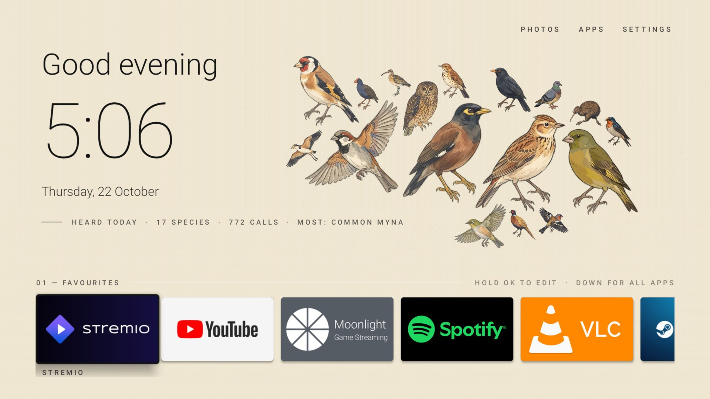
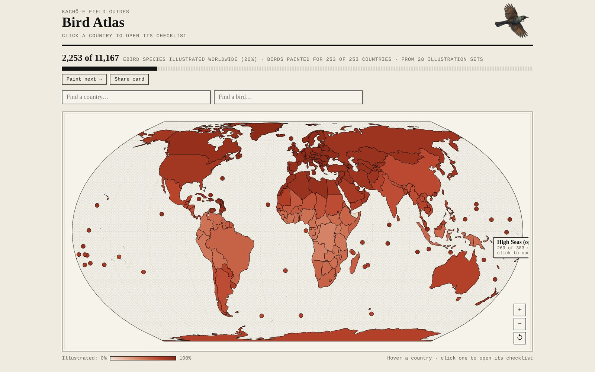
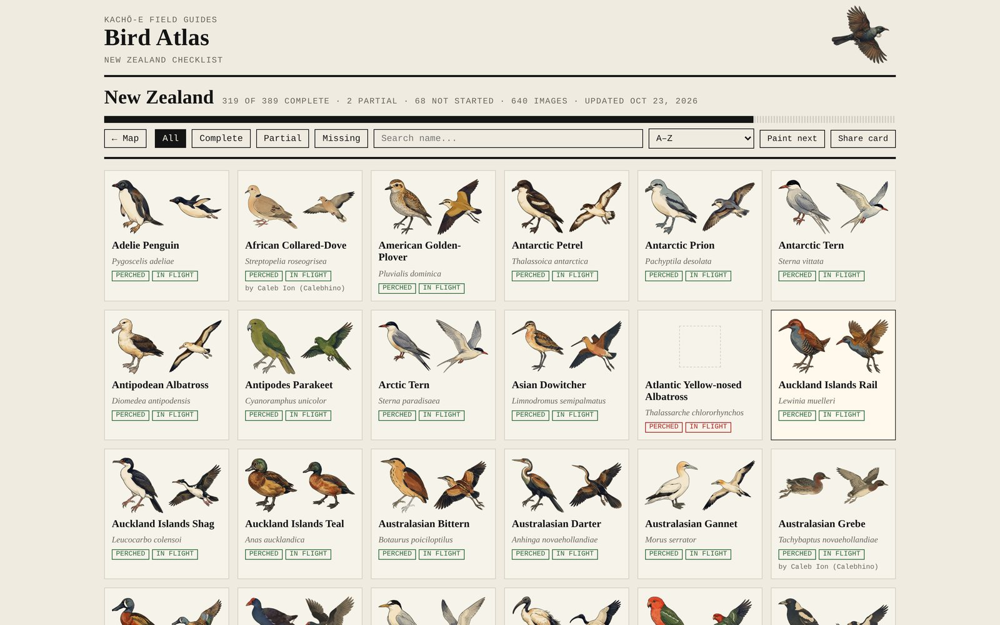

# Avian Visitors — New Zealand

Kachō-e woodblock-style illustrations of New Zealand's birds, built for a
[BirdNET-Go](https://github.com/tphakala/birdnet-go) listening station and a
Home Assistant "Field Journal" card. The style follows the
[Avian Visitors](https://theodore.net/projects/AvianVisitors/) guidelines by Teddy Warner.

<p align="center"><a href="android-tv/README.md"></a></p>
<p align="center"><sub>Our TV home screen: every bird the garden microphone heard today, painted in kachō-e style.
<b><a href="android-tv/README.md">Put it on your Android TV / Nvidia Shield →</a></b></sub></p>

<table>
<tr>
<td width="50%"><a href="https://birds.tandarra.net/atlas.html"></a></td>
<td width="50%"><a href="https://birds.tandarra.net/atlas.html#NZ"></a></td>
</tr>
<tr>
<td align="center"><sub><b>Bird Atlas</b>: 11,167 eBird species, 253 countries, 28 community sets</sub></td>
<td align="center"><sub><b>Checklists</b>: perched and in-flight paintings, credited to each artist</sub></td>
</tr>
</table>

**Live: https://birds.tandarra.net** — every bird heard in the garden in the last 24 hours,
collaged and sized by how often each one called.

**Bird Atlas:** [`atlas.html`](https://birds.tandarra.net/atlas.html) — a world map where each
country with illustrations is shaded by how much of its checklist is painted; click it to open the checklist.

**On your TV:** [`android-tv/`](android-tv/README.md) — how the collage became our Nvidia Shield's home screen, and how to build your own.

**Sets by country:** [`COLLECTIONS.md`](COLLECTIONS.md) — every community Avian Visitors set, linked by country.

**Illustration checklist:** [`birds/master_index.html`](https://birds.tandarra.net/birds/master_index.html) —
every species eBird has recorded in New Zealand (389), with what's been illustrated so far
(also as [`birds/master_index.csv`](birds/master_index.csv)).

## What's in here

| Path | What it is |
|---|---|
| `birds/raw/` | Master paintings as generated, trimmed to the bird (`tools/trim_masters.py`, lossless). Note: Gemini returns JPEG data in these `.png` files |
| `birds/<slug>.webp` | Perched pose, background removed (slug = scientific name, lowercase, hyphenated) |
| `birds/<slug>-2.webp` | Second pose: in flight (penguins swim; kiwi, kākāpō, takahē, weka, ratites walk) |
| `birds/<slug>-3.webp` | Optional extra pose |
| `birds/master_list_NZ.json` | Frozen copy of eBird's NZ species list — the target for the master index |
| `birds/index.json` | Species painted so far (scientific → common name) |
| `birds/master_index.*` | Progress checklist, regenerated by `--progress` |
| `birds/progress_<region>.json` | Compact checklist data for the atlas, also written by `--progress` |
| `birds/world.json` | eBird's world species list + every country's list, built by `--world` (powers search, shading and the world tracker) |
| `birds/painted.json` | Cut-outs per species, written by `--progress` and `--world` |
| `birds/collections.json` | Species illustrated by the community Avian Visitors sets (built by `tools/build_collections.py` from blobless clones, no images copied) |
| `birds/world-extra.json` | Outlines for small islands and territories the base map leaves out, built by `tools/build_world_extra.py` |
| `atlas.html`, `birds/world-110m.json`, `vendor/` | World map front page (d3-geo + Natural Earth 110m via world-atlas); turns and zooms toward the country under the mouse |
| `index.html` | Public live collage page (Cloudflare Pages) |
| `functions/api/today.js` | Last-24h species counts from BirdNET-Go via a path-restricted tunnel |
| `functions/api/clip.js`, `functions/api/audio/[id].js` | Click-to-play: best clip per species (your BirdNET-Go "correct" reviews first, else highest confidence), audio proxied and cached |
| `android-tv/` | Android TV home screen with the daily bird collage as its wallpaper: guide, `BirdWall.java` collage engine, minimal launcher |
| `tools/build_audio.py`, `birds/audio.json` | eBird species codes and one xeno-canto recording per species for the atlas (daily on GitHub) |
| `docs/images/` | Screenshots used in these READMEs |
| `worker.js`, `wrangler.jsonc` | Same site deployed as a Cloudflare Worker instead of Pages |
| `bird_illustrations.py` | Generator, cut-out tool, progress and world-list builder (`nz_bird_illustrations.py` is the old name, kept as a shim) |
| `homeassistant/packages/birdnet.yaml` | MQTT sensors for BirdNET-Go detections + today's running species list |
| `homeassistant/cards/field_journal_card.yaml` | e-ink style dashboard card (needs `button-card`) |

Not committed (see `.gitignore`): API keys, reference photos in `birds/refs/`, and audio clips.

## Style rules

Prompt template adapted from Avian Visitors:

- Edo-period Japanese kachō-e woodblock print, **very few marks** — 2–4 flat colour zones, not feather texture
- Confident sumi-e ink linework, soft watercolour washes
- Earthy palette: burnt umber, ochre, indigo, vermillion, muted greens; crisp ink eye, beak and feet
- Identical warm cream mulberry-paper ground; **no branch, perch or scenery** (perch implied by toe posture)
- Correct anatomy: two wings, two legs, one head, one beak, one tail; markings as the bird appears in NZ
- Two poses per species: perched (one wing folded, other tucked) and in flight (both wings fully extended)

Model: Gemini **Nano Banana 2.1** (`gemini-nano-banana-2.1`), with the tūī used as the style reference.

## Workflow

Requires Python 3 with `pip install requests pillow "rembg[cpu]"`.
Put your keys in `bird_keys.txt` next to the script (ignored by git):

```
GEMINI_API_KEY=...
EBIRD_API_KEY=...
```

```powershell
# See what's left and what it will cost
python bird_illustrations.py --region NZ --list-only

# Paint everything missing, matching the tūī's style
python bird_illustrations.py --region NZ --style-ref "birds\raw\prosthemadera-novaeseelandiae.png"

# Paint a list downloaded from the atlas's "Paint next"
python bird_illustrations.py --list paint_next_world_top50_<date>.txt --style-ref birds/raw/prosthemadera-novaeseelandiae.png

# Images made by hand (Gemini app): save as birds\raw\<slug>.png / <slug>2.png, then
python bird_illustrations.py --cutout-only

# Redo a dud: delete its PNG from birds\raw\ and run again for that bird
python bird_illustrations.py --species "Mallard" --style-ref "birds\raw\prosthemadera-novaeseelandiae.png"

# Rebuild the progress checklist
python bird_illustrations.py --progress

# Refresh the world + per-country eBird lists for the atlas (a few minutes, ~250 eBird calls)
python bird_illustrations.py --world
```

Then commit and push, and copy `birds\*.webp` to Home Assistant at `/config/www/birds/`.

## Home Assistant

1. Copy `homeassistant/packages/birdnet.yaml` into `config/packages/`.
2. Point BirdNET-Go's MQTT output at your broker on topic `birdnet`.
3. Copy the `.webp` files to `config/www/birds/` (served as `/local/birds/`).
4. Add `homeassistant/cards/field_journal_card.yaml` as a Manual card.

BirdNET sometimes uses an older scientific name than eBird (e.g. *Chrysococcyx lucidus*
vs *Chalcites lucidus*). If a detected bird shows no picture, add a copy of its
`.webp` under BirdNET's name.

## Community illustration sets

**[COLLECTIONS.md](COLLECTIONS.md)** indexes every Avian Visitors woodblock set by country (Australia, Canada,
Germany, the Netherlands, New Zealand, Spain, Switzerland, the UK and the US), with links to each artist's
repository and how complete each country is. Images stay in the artists' repositories and are credited to
the set that painted them first. To install or share a set, use the official bundle library at
[avianvisitors.com/bundles](https://avianvisitors.com/bundles). Refresh with `python tools/build_collections.py`.

This runs **automatically every day on GitHub** (`.github/workflows/update-collections.yml`, about 6:20 am NZ).
New Japanese Woodblock packs in the official catalogue are added on their own; other forks that recently
added illustrations are listed in a *New illustration sets to review* issue. To accept one, add it to
`tools/extra_sets.json` under `sets` (`repo`, `branch`, `region`, `creator`, `covers`); to dismiss it, put
`"owner/repo"` under `ignore`. Run it on demand from the repo's **Actions** tab → *Update illustration sets* → *Run workflow*.

## Licence

Illustrations and code are shared under
[CC BY-NC-SA 4.0](https://creativecommons.org/licenses/by-nc-sa/4.0/), matching
Avian Visitors, whose prompt template and style guidelines this project adapts.
Non-commercial use only, with attribution. Images were generated with Google Gemini.
