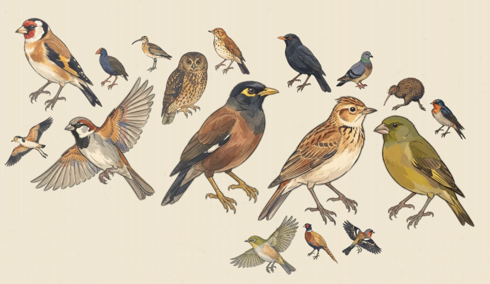
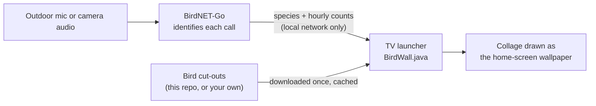
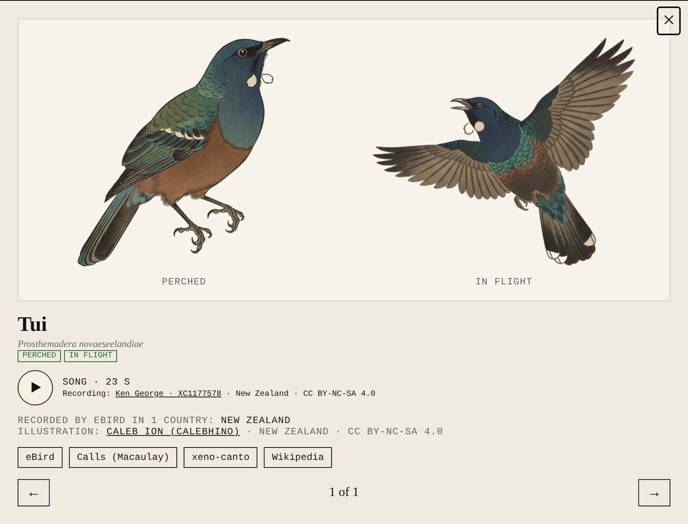
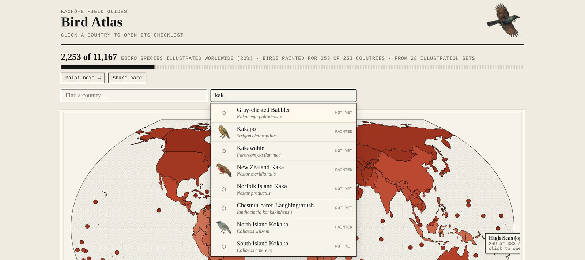

# Today's birds on your TV

<p align="center"></p>

The TV's home screen at our place shows **every bird our garden microphone has heard in the last 24 hours**, painted in the
Avian Visitors kachō-e woodblock style and laid out like a page from a field journal. Birds that called more are drawn bigger. It
redraws itself through the day as new birds turn up, and it costs nothing to run.

<p align="center"></p>
<p align="center"><sub>Nvidia Shield home screen. The summary line reads “Heard today · 17 species · 772 calls · Most: Common Myna”.</sub></p>

This page explains how it works and how to build your own. Our setup is specific to our house, so treat this as a recipe
rather than an installer. You'll need to be comfortable running a few commands.

---

## How it works



1. **[BirdNET-Go](https://github.com/tphakala/birdnet-go)** listens to an outdoor microphone and identifies birds by their calls.
   Its API reports which species it heard today, hour by hour (`/api/v2/analytics/species/daily?date=YYYY-MM-DD`).
2. **A small home-screen app on the TV** asks BirdNET-Go every few minutes what it heard in the last 24 hours.
3. **Each species' painting** is downloaded once and cached. The `<scientific-name>.webp` (perched) and `-2.webp` (in flight)
   cut-outs in [`birds/`](../birds) cover New Zealand, and the [Bird Atlas](https://birds.tandarra.net/atlas.html) links to
   community sets for 16 countries.
4. **The collage is drawn on the TV** at full 4K: a warm mulberry-paper background with faint fibres, then the birds packed from the
   centre outwards. It is only redrawn when the list of birds or their counts change.

Nothing leaves your house. The TV talks to BirdNET-Go over your own network; only the paintings come from the internet.

### The layout, Avian Visitors style

The collage follows the look of [Avian Visitors](https://theodore.net/projects/AvianVisitors/), with layout rules worked out for a TV:

- **Size by calls.** Each bird's area is proportional to *calls^0.65*, so a bird heard 400 times is bigger than one heard twice,
  but doesn't swamp it. All the areas are then scaled to fill a set share of the free space.
- **Packed by silhouette, not by box.** Every painting is turned into a coarse mask of where the bird actually is (with a
  one-cell margin), so a wing can tuck in beside another bird's tail. Birds are placed biggest first, starting from the middle
  and spiralling outwards along a wide ellipse. If they don't all fit, everything shrinks by 7% and it tries again.
- **Room for the screen furniture.** The clock, the summary line, the menu and the app dock are blocked out, so birds never sit
  under text.
- **Variety.** Every third bird is shown in flight, and a fixed ~45% are mirrored so the flock doesn't all face one way. Both
  choices are stable, so the picture doesn't reshuffle every time it redraws.

All of this lives in [`src/com/example/birdhome/BirdWall.java`](src/com/example/birdhome/BirdWall.java), a single file with no
libraries beyond Android itself.

---

## What you need

| | |
|---|---|
| **Android TV box** | Nvidia Shield (what we use). Other Android TV / Google TV devices should work the same way. Amazon Fire TV doesn't let you replace its home screen without workarounds, so use option A there. |
| **BirdNET-Go** | Running somewhere on your network with a microphone outdoors. We run it as a Home Assistant app using a camera's audio. |
| **Bird paintings** | Cut-outs with transparent backgrounds, named by scientific name: `turdus-merula.webp`, `turdus-merula-2.webp`. Use this repo's New Zealand set, a [community set](../COLLECTIONS.md), or paint your own with [`bird_illustrations.py`](../bird_illustrations.py). |
| **A computer** | With [Android platform-tools](https://developer.android.com/tools/releases/platform-tools) (`adb`) to install the app. Option B also needs Java and the Android SDK build tools. Android Studio isn't required. |

---

## Option A: the easy way (a web page)

If you don't want to build an app, show the collage as a web page.
[`index.html`](../index.html) in this repo is the same collage for a browser (it's what runs at
[birds.tandarra.net](https://birds.tandarra.net)). It reads today's birds from a small Cloudflare function
([`functions/api/today.js`](../functions/api/today.js)) that asks BirdNET-Go through a locked-down tunnel.

1. Host `index.html`, `birds/` and `functions/` on Cloudflare Pages (free), and point `BIRDNET_ORIGIN` at your BirdNET-Go.
   Expose **only** the API paths the function needs, and protect them with Cloudflare Access. Don't publish the whole
   BirdNET-Go dashboard.
2. On the TV, use any kiosk-browser or "web page as screensaver" app to open your page full-screen.

It's quick to set up, but a browser on a TV box uses more memory than a native wallpaper and isn't your home screen.

## Option B: a custom home screen (what we built)

A tiny launcher app replaces the stock Android TV home screen. It's fast, has no ads or recommendation rows, and the bird
collage is its wallpaper. This folder has a minimal, working starting point:

| File | What it is |
|---|---|
| [`src/com/example/birdhome/BirdWall.java`](src/com/example/birdhome/BirdWall.java) | The collage engine: fetches today's birds, downloads and caches paintings, packs and draws the collage. |
| [`src/com/example/birdhome/HomeActivity.java`](src/com/example/birdhome/HomeActivity.java) | A minimal home screen: the collage full-screen, a clock and the "heard today" line, refreshed every 5 minutes. |
| [`AndroidManifest.xml`](AndroidManifest.xml) | Registers the app as a home screen (`HOME` category) and as a normal TV app. |
| [`birds.conf.example`](birds.conf.example) | Optional settings: your BirdNET-Go address, where to fetch paintings, hours, collage size. |

Our own launcher adds a greeting, the date, a favourites dock with an all-apps screen, and doorbell camera pop-ups. Those are
yours to add. For the dock, list the apps that have a `LEANBACK_LAUNCHER` activity with `PackageManager` and start them with
`getLeanbackLaunchIntentForPackage()`.

### 1. Turn on network debugging on the TV

On a Shield: **Settings → Device Preferences → About**, then select **Build** seven times until it says you're a developer.
Go back to **Device Preferences → Developer options** and turn on **Network debugging**. Note the TV's IP address from
**Settings → Network**.

### 2. Build the app

Using the Android SDK command-line tools (`$SDK` is your SDK folder, e.g. `%LOCALAPPDATA%\Android\Sdk` on Windows):

```sh
AJ=$SDK/platforms/android-34/android.jar        # any recent platform works
BT=$SDK/build-tools/34.0.0

# compile and convert to Android bytecode
javac -source 8 -target 8 -cp $AJ -d build/classes src/com/example/birdhome/*.java
java -cp $BT/lib/d8.jar com.android.tools.r8.D8 --min-api 26 --lib $AJ --output build $(find build/classes -name '*.class')

# package, add the code, align and sign
$BT/aapt2 link -o build/unsigned.apk -I $AJ --manifest AndroidManifest.xml
(cd build && zip -q unsigned.apk classes.dex)
$BT/zipalign -f 4 build/unsigned.apk build/aligned.apk
keytool -genkeypair -keystore birdhome.keystore -alias birdhome -keyalg RSA -validity 10000 -dname "CN=Bird Home"   # first time only
$BT/apksigner sign --ks birdhome.keystore --out BirdHome.apk build/aligned.apk
```

Keep `birdhome.keystore`. Updates must be signed with the same key, or you'll have to uninstall first.

### 3. Install it and make it the home screen

```sh
adb connect 192.168.1.20:5555                    # your TV's IP; accept the prompt on the TV and tick "Always allow"
adb install -r BirdHome.apk
adb push birds.conf /sdcard/Android/data/com.example.birdhome/files/birds.conf   # optional, after editing it
adb shell cmd package set-home-activity com.example.birdhome/.HomeActivity
adb shell input keyevent KEYCODE_HOME
```

Press Home on the remote and the birds appear. The first draw takes a few seconds while the paintings download; after that
they come from the cache.

### 4. Going back to the stock home screen

Nothing is uninstalled or switched off, so undoing it is one command:

```sh
adb shell cmd package set-home-activity com.google.android.tvlauncher/.MainActivity
```

On Google TV devices the stock launcher has a different name. Check with
`adb shell cmd package query-activities -a android.intent.action.MAIN -c android.intent.category.HOME`.

---

## Tips

- **No birds yet?** The summary line shows "Listening for birds" until BirdNET-Go reports something. Check you can open
  `http://<birdnet-go>:8080/api/v2/analytics/species/daily?date=<today>` from a browser on the same network.
- **Missing paintings** are skipped and retried after an hour, so a bird without a painting simply doesn't appear. The
  [Bird Atlas](https://birds.tandarra.net/atlas.html) shows which species have paintings and links to every community set.
- **Using your own paintings:** put them on any web server on your network (Home Assistant's `www` folder works:
  `http://homeassistant.local:8123/local/birds/`) and set `img1` in `birds.conf`.
- **Too busy or too sparse?** Change `budget` in `birds.conf` (e.g. `0.8` or `1.2`), or `hours` to show a shorter window.
- **Licences:** the paintings in this repo are CC BY-NC-SA 4.0. Community sets have their own licences, listed in
  [COLLECTIONS.md](../COLLECTIONS.md). Keep it non-commercial and credit the artists.

---

## Also in this project

<table>
<tr>
<td width="50%"><a href="https://birds.tandarra.net/atlas.html"></a><br><b>Bird Atlas</b>: every eBird country shaded by how many of its birds have been painted, from 28 community sets.</td>
<td width="50%"><a href="https://birds.tandarra.net/atlas.html#NZ"></a><br><b>Country checklists</b>: perched and in-flight paintings for each species, with who painted them.</td>
</tr>
<tr>
<td width="50%"><br><b>Species cards</b>: both paintings, a recording of its song from xeno-canto, and where in the world it's found.</td>
<td width="50%"><br><b>Search any bird</b>: all 11,167 eBird species, showing which are painted and which still need an artist.</td>
</tr>
</table>
